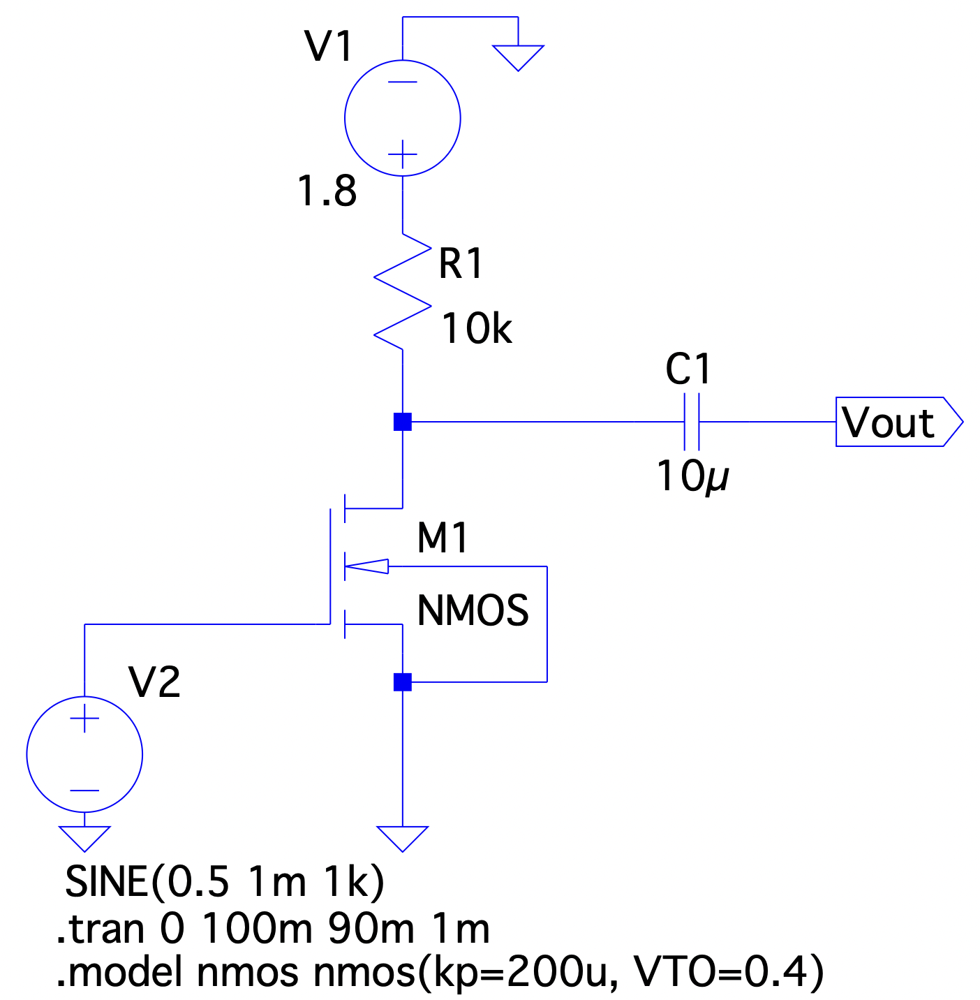
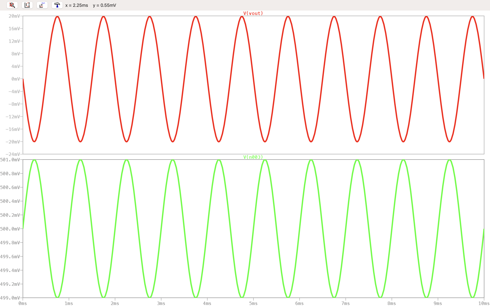
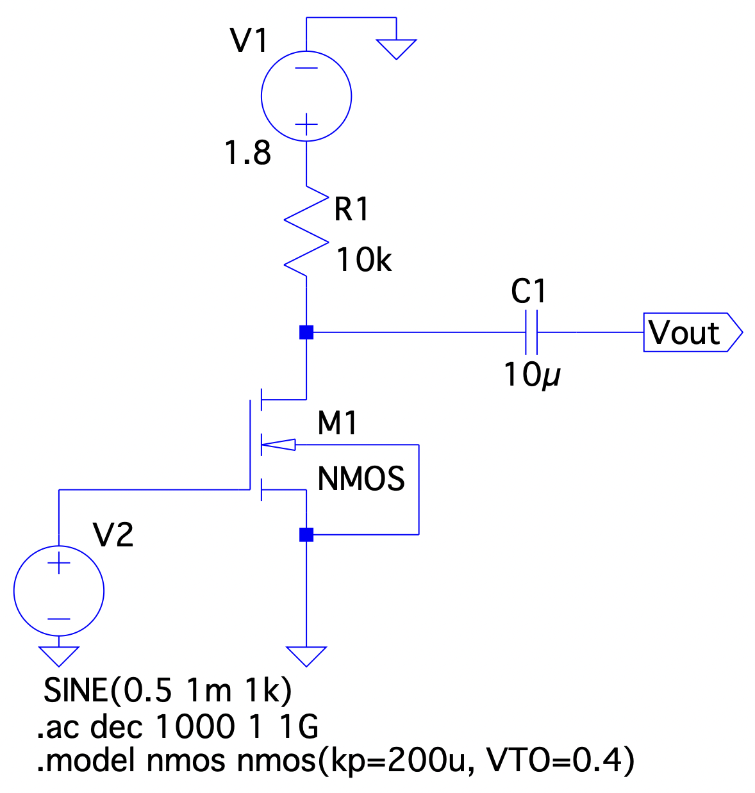
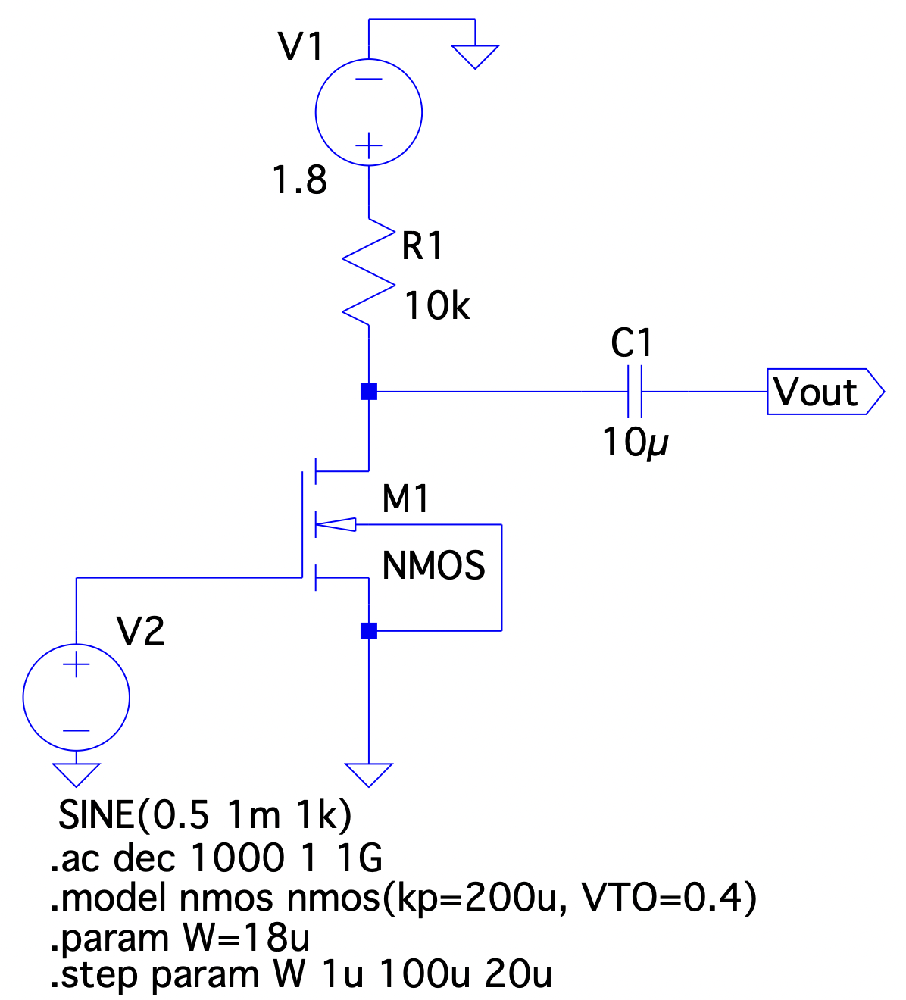
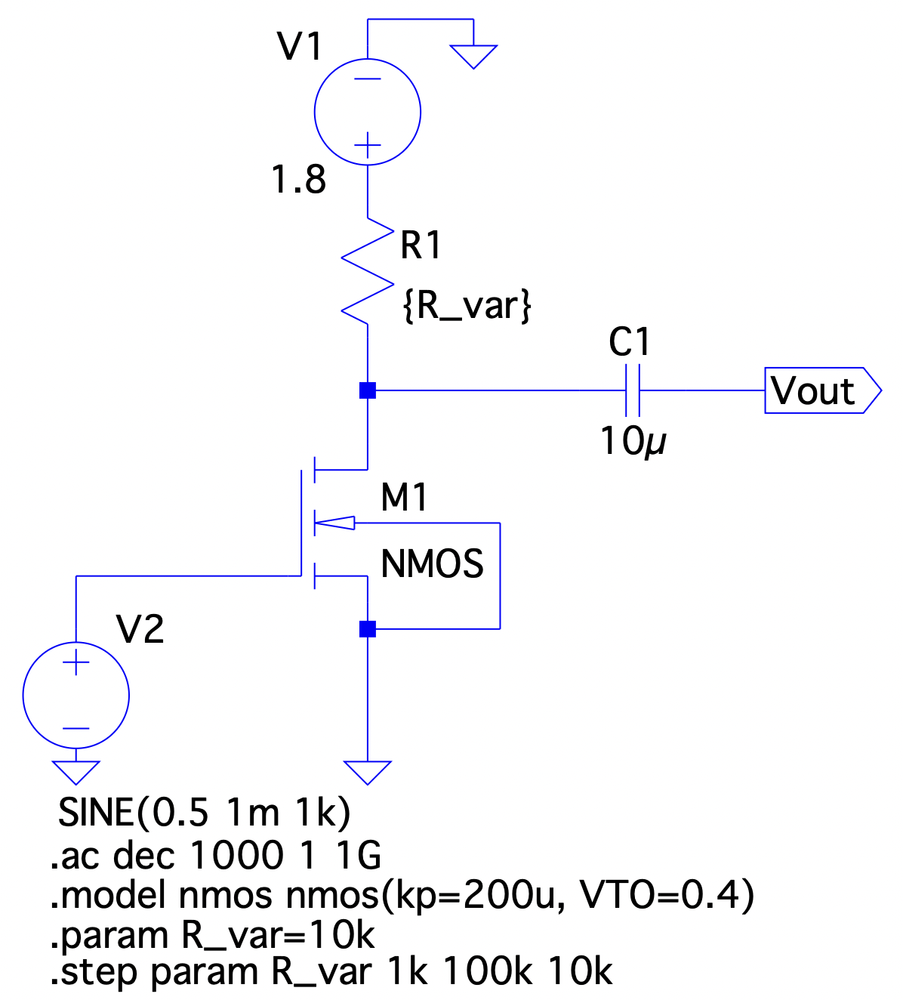
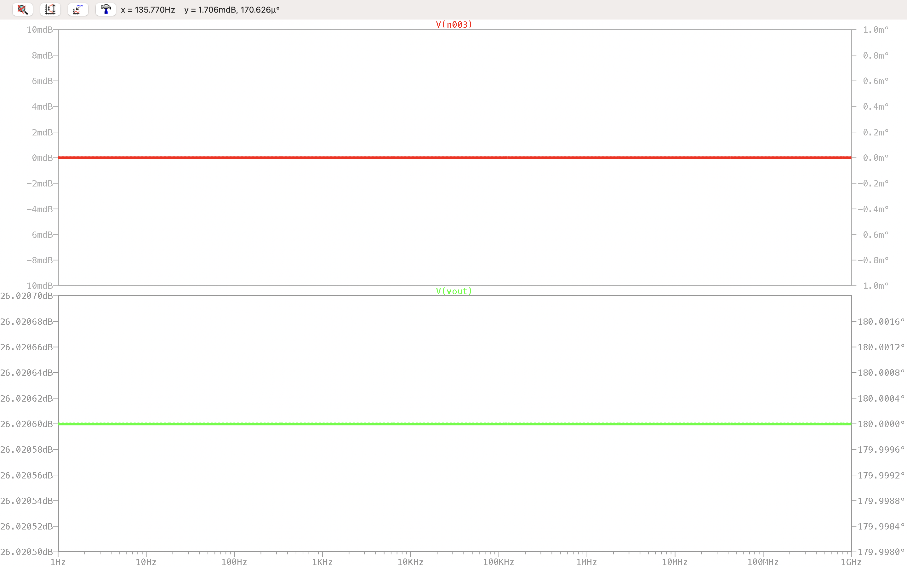
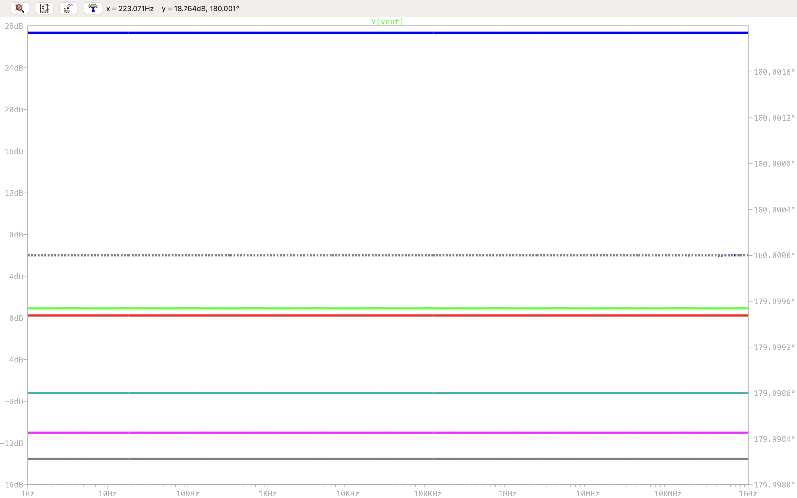
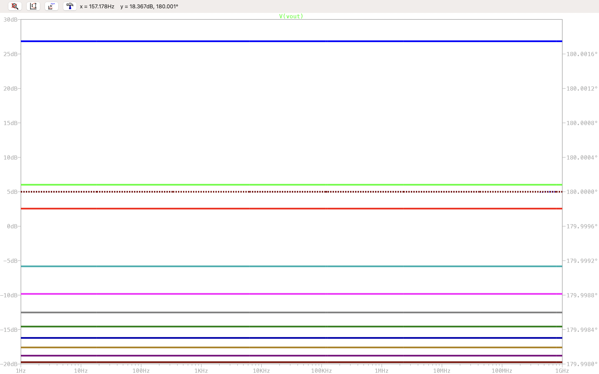

# Experiment 8 — Common Source Amplifier with Resistive Load

## Aim

To design, simulate, and analyze a **Common Source (CS) Amplifier** with a resistive drain load in LTSpice using a user-defined NMOS model.

**Part A — Transient Analysis:**
1. Design a common source amplifier with V_DD = 1.8 V, R_D = 10 kΩ, and an NMOS transistor biased at V_GS = 0.5 V.
2. Verify the DC operating point and confirm saturation-region operation.
3. Perform a transient analysis and observe the output waveform.
4. Calculate the theoretical voltage gain (A_v = −g_m·R_D) and compare with the simulated voltage gain from peak-to-peak measurements.

**Part B — AC Analysis:**
1. Perform an AC analysis (Bode plot) using a logarithmic frequency sweep from 1 Hz to 1 GHz with 1000 points per decade.
2. With R_D = 10 kΩ fixed, vary W from 1 µm to 100 µm (step 20 µm) and observe the gain variation.
3. With W = 18 µm fixed, vary R_D from 1 kΩ to 100 kΩ (step 10 kΩ) and observe the gain variation.

## Apparatus Required

- Computer system with LTSpice simulation software
- User-defined NMOS model: `.model nmos nmos(kp=200u, VTO=0.4)`

---

## Theory

### Common Source Amplifier

The Common Source (CS) amplifier is the most fundamental single-stage MOSFET amplifier configuration. The input signal is applied at the gate and the amplified output is taken from the drain, with the source terminal common to both.

- **Drain resistor R_D:** converts drain current variation into output voltage swing.
- **Coupling capacitor C₁:** blocks DC bias from the output while passing the AC signal.
- **Bias voltage V_GS:** sets the DC operating point; the transistor must be in **saturation** for linear amplification.

The output is 180° out of phase with the input: when v_gs increases, i_D increases, the drop across R_D increases, so v_DS = V_DD − i_D·R_D decreases.

### DC Operating Point

For saturation: `V_DS ≥ V_GS − V_TH`.

Drain current in saturation:
```
I_D = (1/2)·μn·Cox·(W/L)·(V_GS − V_TH)²
```

Drain voltage:
```
V_DS = V_DD − I_D·R_D
```

### Transconductance and Voltage Gain

```
g_m = μn·Cox·(W/L)·(V_GS − V_TH)

Av = −gm·RD          |Av|_dB = 20·log10(gm·RD)
```

Since g_m ∝ W, both W and R_D scale the gain linearly — provided the transistor remains in saturation.

### Saturation Limits for Parametric Sweeps

For fixed V_GS = 0.5 V, V_TH = 0.4 V, V_DD = 1.8 V:

**Maximum R_D for saturation** (at W = 18 µm, I_D = 0.1 mA):
```
RD,max = (VDD − VDS,sat) / ID = (1.8 − 0.1) / 0.1 mA = 17 kΩ
```

**Maximum W for saturation** (at R_D = 10 kΩ):
```
Wmax/L = 2(VDD − VDS,sat) / [μn·Cox·(VGS−VTH)²·RD] = 2×1.7 / (200e-6 × 0.01 × 1e4) = 170
⇒ Wmax ≈ 30.6 µm
```

For W ≥ 41 µm or R_D ≥ 21 kΩ, the transistor enters triode and the gain formula |Av| = gm·RD no longer applies.

### AC Analysis in LTSpice

The `.ac` directive performs a small-signal linear frequency sweep. LTSpice finds the DC operating point, replaces all nonlinear devices with their small-signal equivalents, and computes the complex transfer function V_out/V_in(ω). For the ideal NMOS model used here (no parasitic capacitances), the gain is frequency-independent and the Bode plot is a flat horizontal line.

---

## LTSpice Simulation Code

[`code/cs_amplifier_resistive_load.cir`](code/cs_amplifier_resistive_load.cir) — a single reference netlist covering both parts of the experiment: the ideal square-law NMOS model (`kp=200u, VTO=0.4`, no parasitic capacitances), the resistive drain load, and the coupling capacitor. Directive blocks for the transient run, the baseline AC sweep, the W-parametric sweep (`.step param W ...`), and the R_D-parametric sweep (`.step param R_var ...`) are all included — switch between them by commenting/uncommenting the relevant lines, as noted in the file.

---

## Part A — Transient Analysis

### Circuit Parameters

- V_DD = 1.8 V; R_D = 10 kΩ; C₁ = 10 µF
- NMOS: μn·Cox = 200 µA/V², V_TH = 0.4 V, W = 18 µm, L = 0.18 µm
- Input V2: `SINE(0.5 1m 1k)` — offset 0.5 V, amplitude 1 mV, frequency 1 kHz
- Directive: `.tran 0 100m 90m 1m`

### Circuit Schematic



*Common source amplifier schematic in LTSpice (Part A).*

### DC Operating Point

```
W/L = 18µm / 0.18µm = 100
ID  = 0.5 × 200e-6 × 100 × (0.5−0.4)² = 0.1 mA
VDS = 1.8 − (0.1e-3)(10e3) = 0.8 V

VDS = 0.8 V  >>  VDS,sat = 0.1 V   ⇒  Transistor is in Saturation ✓
```

| Parameter | Value |
|---|---|
| V_GS | 0.5 V |
| V_TH | 0.4 V |
| V_GS − V_TH | 0.1 V |
| I_D | 0.1 mA |
| V_DS | 0.8 V |
| Region of operation | Saturation |

### Theoretical Voltage Gain

```
gm = 200e-6 × 100 × 0.1 = 2 mA/V
Av = −gm·RD = −(2e-3)(10e3) = −20
```

### Transient Simulation Results



*Transient waveforms: V(vout) (output) and V(n003) (input at gate). Both at 1 kHz.*

From the waveform:
- Input peak-to-peak: (V_p-p)_in ≈ 2 mV
- Output peak-to-peak: (V_p-p)_out ≈ 40 mV

### Simulated Voltage Gain

```
|Av|_sim = 40mV / 2mV = 20
```

### Comparison — Theoretical vs. Simulated

| Parameter | Theoretical | Simulation |
|---|---|---|
| g_m (mA/V) | 2.0 | — |
| \|Av\| | 20 | 20 |
| Phase shift | 180° | 180° |
| (V_p-p)_out | 40 mV | ≈ 40 mV |

### Discussion — Part A

The transient simulation confirms linear voltage amplification. The DC operating point (V_DS = 0.8 V ≫ V_DS,sat = 0.1 V) ensures the transistor remains well within saturation throughout the signal swing, validating the small-signal model.

The output at V(vout) is a clean 1 kHz sinusoid with 20 mV peak amplitude — exactly 20 times the 1 mV input, confirming |Av| = 20. The 180° phase inversion is clearly visible: when the input rises, the output falls, consistent with Av = −gm·RD.

The coupling capacitor (X_C ≈ 15.9 Ω ≪ R_D = 10 kΩ at 1 kHz) acts as a short circuit for the signal while blocking the 0.8 V DC drain bias from the output.

### Conclusion — Part A

A CS amplifier with W/L = 100, R_D = 10 kΩ was successfully simulated. The transistor was biased in saturation (I_D = 0.1 mA, V_DS = 0.8 V). The simulated gain |Av| = 20 matched the theoretical value gm·RD = 20 exactly, and the 180° phase inversion was clearly confirmed.

---

## Part B — AC Analysis

### AC Analysis Directive

```
.ac dec 1000 1 1G
```

Logarithmic sweep, 1000 points/decade, from 1 Hz to 1 GHz. AC input amplitude set to 1 V for direct gain readout.

### (i) Baseline: Fixed W = 18 µm, R_D = 10 kΩ



*CS amplifier schematic for AC analysis. Fixed W = 18 µm, R_D = 10 kΩ.*

### (ii) W Parametric Sweep (R_D = 10 kΩ fixed)

Directive added: `.step param W 1u 100u 20u` — steps: W = 1, 21, 41, 61, 81 µm (five runs).



*Schematic for W-parametric AC sweep. W stepped from 1 µm to 100 µm in steps of 20 µm; R_D = 10 kΩ fixed.*

### (iii) R_D Parametric Sweep (W = 18 µm fixed)

Directive added: `.step param R_var 1k 100k 10k` — steps: R_D = 1, 11, 21, ..., 91 kΩ (ten runs).



*Schematic for R_D-parametric AC sweep. R_D stepped from 1 kΩ to 100 kΩ in steps of 10 kΩ; W = 18 µm fixed.*

### Theoretical Gain — Baseline

```
|Av| = gm·RD = 2mA/V × 10kΩ = 20     ⇒   |Av|_dB = 20·log10(20) ≈ 26.02 dB
```

### Baseline AC Bode Plot



*AC frequency response (baseline). Top: input V(n003) at 0 dB. Bottom: output V(vout) flat at 26.02 dB, phase = 180° across 1 Hz–1 GHz.*

Simulated gain: 10^(26.02/20) ≈ 20 — agrees with theoretical prediction.

### (ii) W Variation — Theoretical Gain Table

| W (µm) | W/L | g_m (mA/V) | I_D (mA) | V_DS (V) | \|Av\|_dB |
|---|---|---|---|---|---|
| 1 | 5.56 | 0.111 | 0.006 | 1.74 | 0.91 |
| 21 | 116.7 | 2.33 | 0.117 | 0.63 | 27.35 |
| 41 | 227.8 | 4.56 | 0.228 | −0.48† | — |
| 61 | 338.9 | 6.78 | 0.339 | −1.59† | — |
| 81 | 450.0 | 9.00 | 0.450 | −2.70† | — |

† Calculated V_DS < 0: transistor in triode; saturation formula invalid.

### W-Parametric Sweep — Result



*AC gain V(vout) for W = 1, 21, 41, 61, 81 µm (R_D = 10 kΩ fixed). Gain increases with W for devices in saturation; triode-region devices show reduced, compressed gain.*

- All traces are flat, confirming frequency-independent gain (no parasitic capacitances in the model).
- Gain increases from ≈0.9 dB (W = 1 µm) to ≈27.4 dB (W = 21 µm) — both in saturation.
- For W ≥ 41 µm (triode), traces compress and gain no longer follows |Av| = gm·RD.
- Phase remains at 180° for all traces.

### (iii) R_D Variation — Theoretical Gain Table

| R_D (kΩ) | I_D·R_D (V) | V_DS (V) | Saturation | \|Av\|_dB |
|---|---|---|---|---|
| 1 | 0.10 | 1.70 | Yes | 6.02 |
| 11 | 1.10 | 0.70 | Yes | 26.83 |
| 21 | 2.10 | −0.30† | No | — |
| 31 | 3.10 | −1.30† | No | — |
| ... | ... | ... | (triode for all R_D > 17 kΩ) | ... |

† Transistor in triode; R_D,max = 17 kΩ for saturation at this bias.

### R_D-Parametric Sweep — Result



*AC gain V(vout) for R_D = 1 kΩ to 91 kΩ in steps of 10 kΩ (W = 18 µm fixed). The two lowest traces correspond to saturation-region operation; higher R_D values push the transistor into triode.*

- All traces are flat — resistive load gives frequency-independent gain.
- R_D = 1 kΩ: |Av|_dB ≈ 6 dB (|Av| = 2) — matches theory.
- R_D = 11 kΩ: |Av|_dB ≈ 26.8 dB (|Av| ≈ 22) — matches theory.
- For R_D ≥ 21 kΩ, transistor enters triode and gain deviates from gm·RD.

### Summary of AC Results

| Case | Parameters | Theoretical (dB) | Simulated (dB) |
|---|---|---|---|
| Baseline | W=18µm, R_D=10kΩ | 26.02 | 26.02 |
| W-sweep min | W=1µm, R_D=10kΩ | 0.91 | ≈0.9 |
| W-sweep (in sat.) | W=21µm, R_D=10kΩ | 27.35 | ≈27.4 |
| R_D-sweep min | W=18µm, R_D=1kΩ | 6.02 | ≈6.0 |
| R_D-sweep (in sat.) | W=18µm, R_D=11kΩ | 26.83 | ≈26.8 |

### Discussion — Part B

**Flat Bode response.** All magnitude plots are perfectly flat from 1 Hz to 1 GHz. This is expected since the NMOS model (`kp=200u, VTO=0.4`) contains no parasitic capacitances. In a real device, C_gs and C_gd (Miller effect) would introduce a high-frequency roll-off.

**Effect of W.** Since gm = μn·Cox·(W/L)·(V_GS−V_TH), increasing W raises g_m and hence |Av|. However, larger W also increases I_D, raising the drop across R_D and reducing V_DS. Beyond W_max ≈ 30.6 µm the transistor enters triode and gain drops below the saturation prediction.

**Effect of R_D.** With W fixed, g_m and I_D are constant. Gain scales as gm·RD until R_D exceeds 17 kΩ, at which point the device is pushed into triode and the linear relationship breaks down.

**Design implication.** To maximize gain while maintaining saturation, the constraint R_D ≤ (V_DD − V_DS,sat)/I_D must be respected. A higher V_DD or a smaller bias current (smaller W or lower V_GS) can extend the usable range of R_D.

### Conclusion — Part B

AC analysis confirmed a flat midband gain of 26.02 dB (|Av| = 20) and constant 180° phase over the full sweep, in exact agreement with theory. Parametric sweeps showed that gain scales linearly with both W and R_D in the saturation region, but deviates once the device enters triode. The saturation boundaries were correctly predicted by the DC operating-point analysis, validating the need to check bias conditions before targeting a specific gain value in CS amplifier design.
