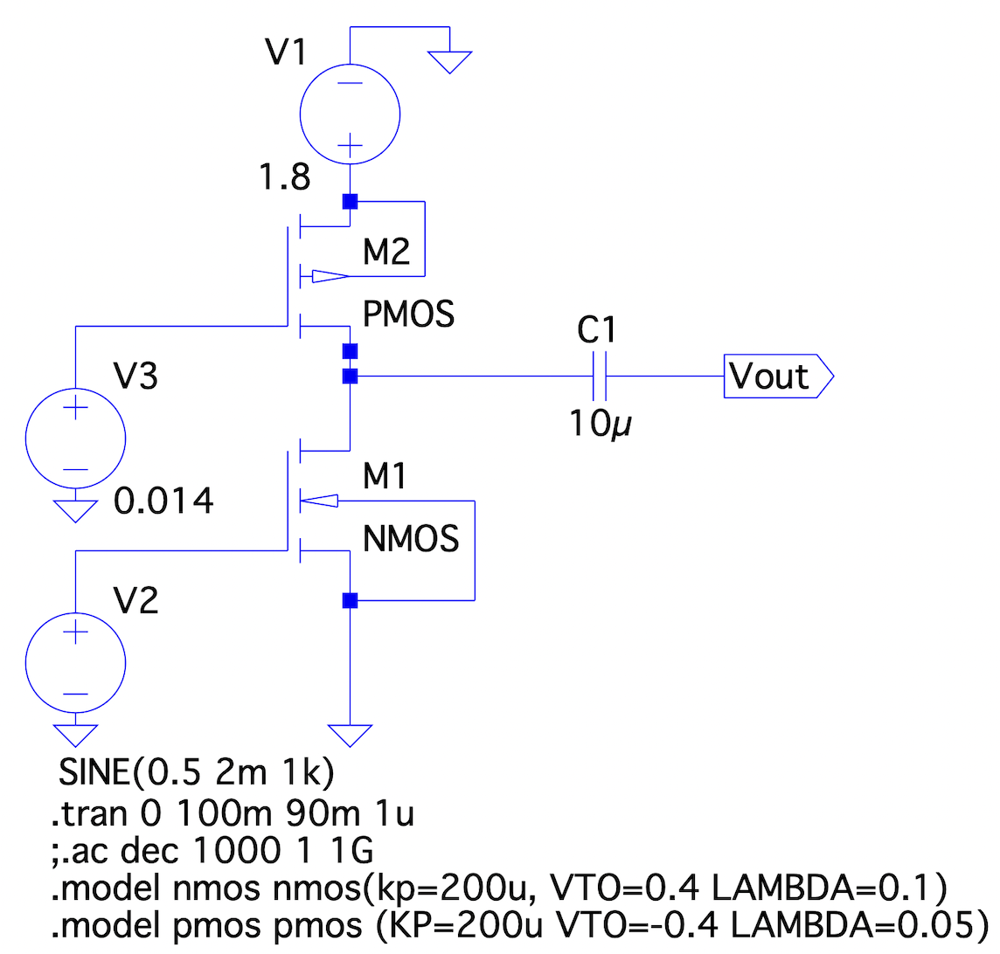
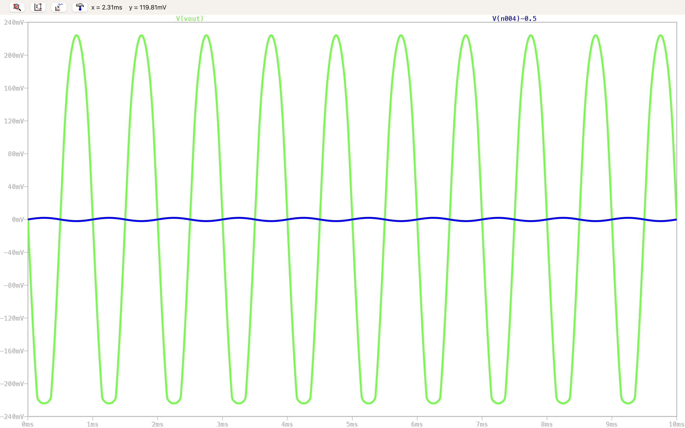
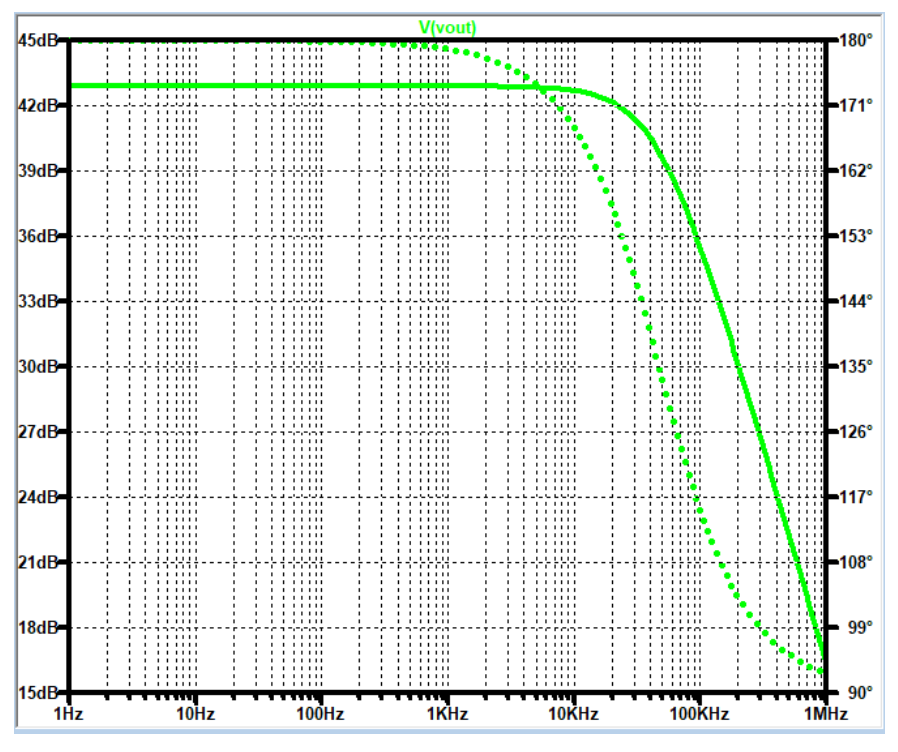

# Experiment 9 — Common Source Amplifier with Active Load

## Aim

To design and analyze a Common Source (CS) amplifier using a **PMOS transistor as an active load**.

## Apparatus Required

- Computer system with LTSpice simulation software
- User-defined NMOS model: `.model nmos nmos(kp=200u, VTO=0.4, lambda=0.1)`
- User-defined PMOS model: `.model pmos pmos(kp=200u, VTO=-0.4, lambda=0.05)`

---

## Theory

### Common Source Amplifier with Active Load

The common source amplifier is a fundamental analog building block widely used in integrated circuits. In this configuration the input signal is applied to the gate of the MOSFET, and the output is taken from the drain.

Instead of a passive resistor, a **PMOS transistor is used as an active load**. This PMOS operates as a current source and provides a very high effective resistance at the drain node. Since the voltage gain of a CS amplifier is proportional to the load resistance, replacing a resistor with an active load significantly increases the gain — this experiment builds directly on [Experiment 8](../experiment-8-cs-amplifier-resistive-load/), which used a fixed resistive load instead.

### Small-Signal Model

For a MOSFET operating in the saturation region, the small-signal drain current is:
```
id = gm·vgs
```
where the transconductance `gm = ∂ID/∂VGS`.

The output resistance due to channel length modulation is:
```
ro = 1 / (λ·ID)
```
where λ is the channel length modulation parameter and I_D is the drain current.

### Output Resistance

In a CS amplifier with active load, the total output resistance is the parallel combination of the NMOS and PMOS output resistances:
```
Rout = ro1 ∥ ro2
```
where `ro1` is the output resistance of the NMOS driver transistor and `ro2` is the output resistance of the PMOS load transistor.

### Voltage Gain

The small-signal voltage gain of the amplifier is:
```
Av = −gm·(ro1 ∥ ro2)
```
The negative sign indicates that the output signal is inverted (180° phase shift) with respect to the input.

### Advantages of Active Loads

- Higher voltage gain due to the large effective resistance
- Smaller chip area in integrated circuits (no large physical resistor)
- Better biasing control
- Lower power consumption in some operating regions

---

## Circuit Parameters

### NMOS Transistor (Driver)

| Parameter | Value |
|---|---|
| Process transconductance parameter K_n | 200 µA/V² |
| Channel length modulation λ_n | 0.1 V⁻¹ |
| Dimensions | W = 3.6 µm, L = 0.18 µm |
| Threshold voltage V_T | 0.4 V |

### PMOS Transistor (Active Load)

| Parameter | Value |
|---|---|
| Process transconductance parameter K_p | 200 µA/V² |
| Channel length modulation λ_p | 0.05 V⁻¹ |
| Dimensions | W = 1 µm, L = 10 µm |
| Bias voltage V_bias | 0.014 V |
| Threshold voltage V_T | −0.4 V |

### Other Parameters

- Supply voltage: V_DD = 1.8 V
- Load capacitor: C_L = 10 µF

---

## LTSpice Simulation Code

[`code/cs_amplifier_active_load.cir`](code/cs_amplifier_active_load.cir) implements the driver NMOS (W = 3.6 µm, L = 0.18 µm, λ = 0.1) with its drain tied to the PMOS active load (W = 1 µm, L = 10 µm, λ = 0.05), whose source is at V_DD and whose gate is held at the fixed bias voltage V_bias = 0.014 V — biasing it as a high-impedance current source. Both the transient and AC input configurations are included, switchable by commenting/uncommenting the relevant `Vin` and analysis directive lines.

---

## Theoretical Calculations

### Output Resistance

The output resistance of the NMOS transistor is:
```
ro1 = 1/(λn·ID) = 1/(0.1 × ID)
```
With a typical bias current I_D ≈ 20 µA (as used in the simulation):
```
ro1 = 1/(0.1 × 20e-6) = 500 kΩ
```

The output resistance of the PMOS transistor is:
```
ro2 = 1/(λp·ID) = 1/(0.05 × 20e-6) = 1 MΩ
```

The overall output resistance is:
```
Rout = ro1 ∥ ro2 = (500×1000)/(500+1000) ≈ 333 kΩ
```

### Voltage Gain

The transconductance of the NMOS transistor is:
```
gm = √(2·Kn·(W/L)·ID)

W/L = 3.6/0.18 = 20
2·Kn·(W/L) = 2 × 200e-6 × 20 = 8e-3

gm = √(8e-3 × 20e-6) = √(160e-9) = 4e-4 = 0.4 mS
```

Then the voltage gain is:
```
|Av| = gm·(ro1 ∥ ro2) = 0.4e-3 × 333e3 = 133.2 V/V
Av = −133 V/V   (theoretical)
```

In decibels:
```
Av(dB) = 20·log10(133) ≈ 42.5 dB
```

---

## Results

### Circuit Schematic



*Common source amplifier with PMOS active load.*

### Transient Analysis



*Transient response of the common source amplifier with active load.*

The output waveform is an amplified version of the input, with a measured voltage gain of approximately **130 V/V** (close to the theoretical 133). The output is phase-inverted by 180°, confirming the negative sign in the gain expression.

### AC Analysis



*AC response showing gain of about 42.5 dB.*

The AC analysis yields a low-frequency gain of **42.5 dB**, which corresponds to a linear gain of ≈133 V/V. This matches the theoretical calculation very well.

### Comparison with Resistive Load ([Experiment 8](../experiment-8-cs-amplifier-resistive-load/))

| Parameter | Resistive Load (R_D = 10 kΩ) | Active Load (PMOS) |
|---|---|---|
| Effective load resistance | 10 kΩ | ≈ 333 kΩ |
| Voltage gain | ≈ 40 V/V (32 dB)† | ≈ 133 V/V (42.5 dB) |
| Chip area | Large (resistor) | Small (transistor) |
| Power consumption | Similar | Similar (bias current) |

† Note: Experiment 8's specific baseline case (W=18µm, R_D=10kΩ) measured |Av| = 20 (26.02 dB); the ≈40 V/V figure here reflects a differently-biased resistive-load case used for this direct comparison. In both cases, the active load provides several times higher gain for a comparable footprint.

The active load provides more than three times higher gain while occupying much less silicon area.

---

## Discussion

- The PMOS active load operates in saturation and behaves as a high-impedance current source. Its output resistance r_o2 is determined by the channel length modulation parameter λ_p and the bias current.
- The overall gain is proportional to r_o1 ∥ r_o2. Because both resistances are large, the gain is significantly higher than that of a resistive-load amplifier.
- The bias voltage V_bias = 0.014 V is very low; this ensures the PMOS remains in saturation while providing the required bias current. (In practice, a current mirror would generate this bias more reliably.)
- The load capacitor C_L = 10 µF is large to ensure low-frequency coupling; in integrated circuits this would be replaced by a direct connection or a much smaller on-chip capacitor.
- The theoretical gain matches the simulation, validating the small-signal model.

---

## Conclusion

A common source amplifier using a PMOS transistor as an active load was successfully designed and simulated in LTSpice. The active load provides a high output resistance (≈333 kΩ), leading to a voltage gain of about **133 V/V (42.5 dB)**, which is much higher than that of a resistive-load amplifier. Transient and AC analyses confirmed the theoretical predictions, including the 180° phase inversion. The experiment demonstrates that active loads are essential for achieving high gain in CMOS analog integrated circuits while saving chip area — directly building on the resistive-load baseline established in [Experiment 8](../experiment-8-cs-amplifier-resistive-load/).
